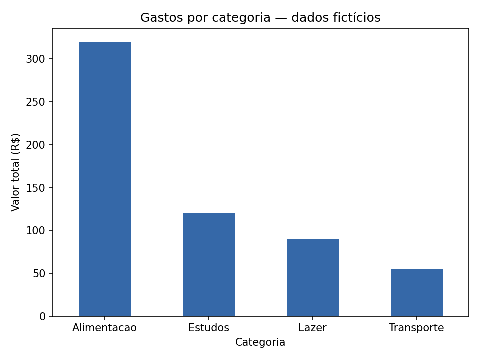

# Análise de gastos por categoria

**Pergunta:** qual categoria concentra o maior valor gasto?

Projeto introdutório com 16 despesas **inteiramente fictícias** de uma semana. Os valores não representam as finanças de nenhuma pessoa. A fonte é o CSV criado para este exercício, disponível no próprio repositório.

## Executar

Baixe os arquivos e abra o terminal na pasta do projeto:

```bash
python -m pip install -r requirements.txt
python analise_gastos.py
```

Validado com Python 3.12, pandas 2.2.3 e Matplotlib 3.10.8. O programa imprime os resultados e salva `grafico_gastos.png`. Depois da instalação das bibliotecas, funciona localmente sem internet.

## Resultado da execução

| Categoria | Total |
| --- | ---: |
| Alimentacao | R$ 320,00 |
| Estudos | R$ 120,00 |
| Lazer | R$ 90,00 |
| Transporte | R$ 55,00 |
| **Total geral** | **R$ 585,00** |

A média foi de **R$ 36,56 por registro de despesa**. Não é a média por dia nem por categoria. Alimentação concentrou o maior valor nesta tabela fictícia; os dados não permitem concluir nada sobre gastos de pessoas reais.



## Entendendo o código

- `read_csv()` lê `gastos.csv`; `head()` mostra seus cinco primeiros registros.
- `gastos["valor"]` seleciona a coluna de valores.
- `sum()` calcula o total e `mean()` calcula a média.
- `groupby("categoria")["valor"].sum()` soma as despesas de cada categoria.
- `sort_values(ascending=False)` organiza do maior para o menor; `index[0]` pega o nome da primeira categoria.
- `plot(kind="bar")` cria as barras e `savefig()` salva a imagem.

As colunas do CSV são `data`, `categoria`, `descricao` e `valor` em reais. Cada linha corresponde a uma despesa. Para simplificar o exercício, a tabela já está preenchida e contém somente valores positivos; o script não trata registros inválidos.

O script foi executado sem erros. Uma conferência separada confirmou o total, a média e os quatro totais por categoria, e o gráfico foi inspecionado visualmente.

**Para praticar:** adicione uma nova despesa no CSV e execute novamente. Observe se a categoria com maior gasto mudou.

Desenvolvido com assistência de IA para estudo. Código e dados fictícios sob licença [MIT](LICENSE).
